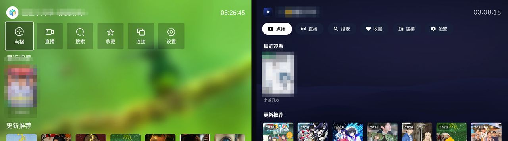
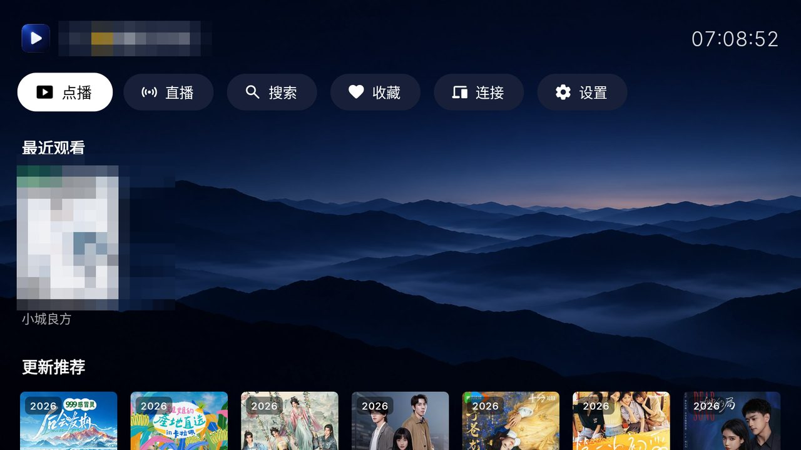
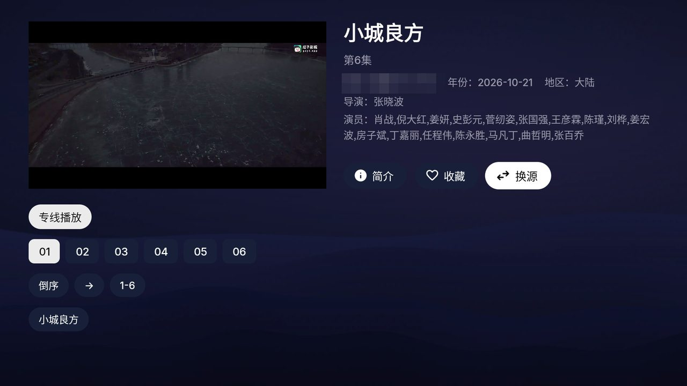
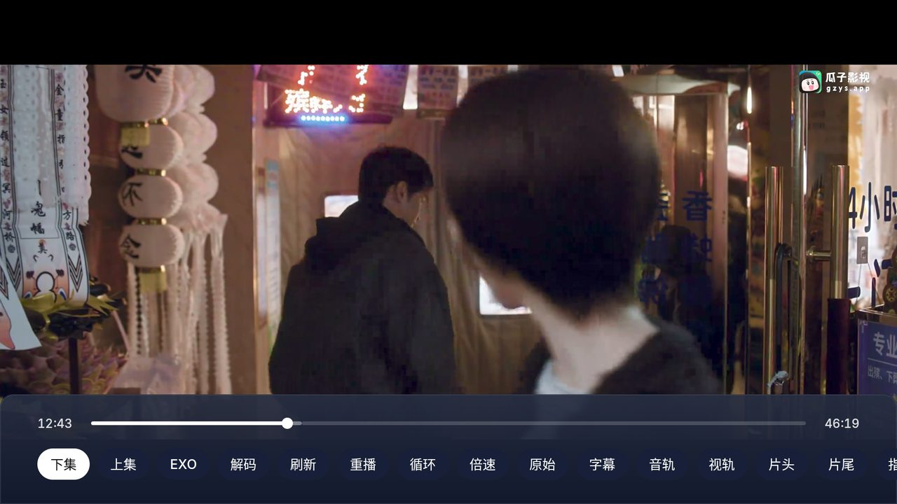
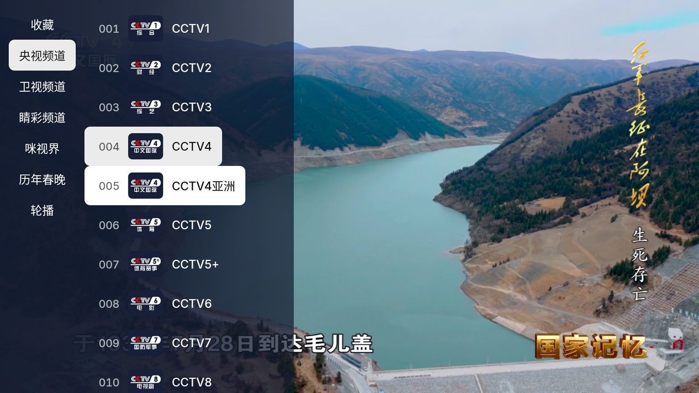
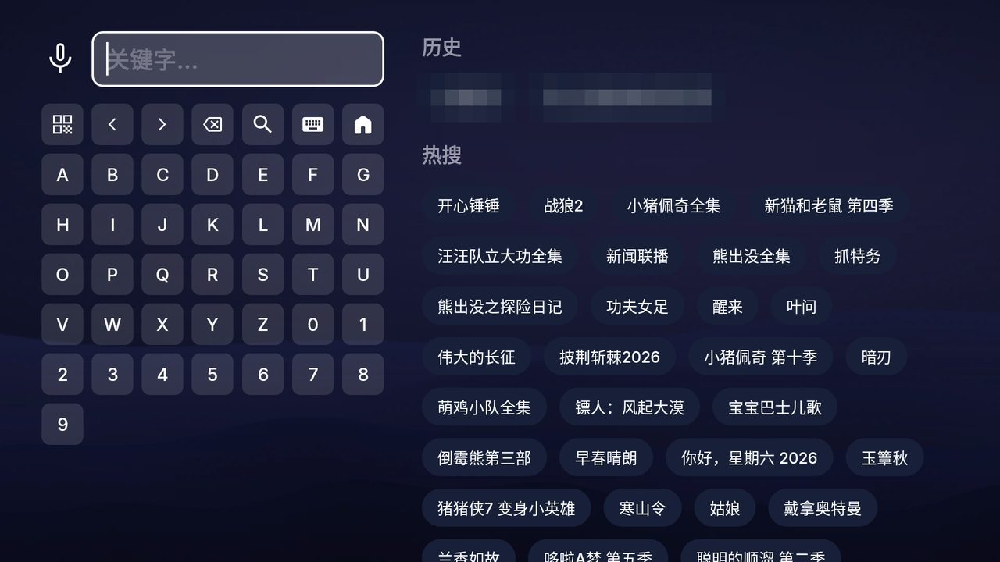
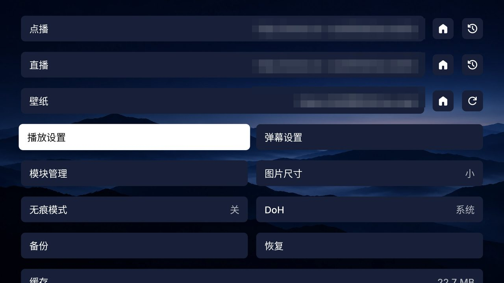
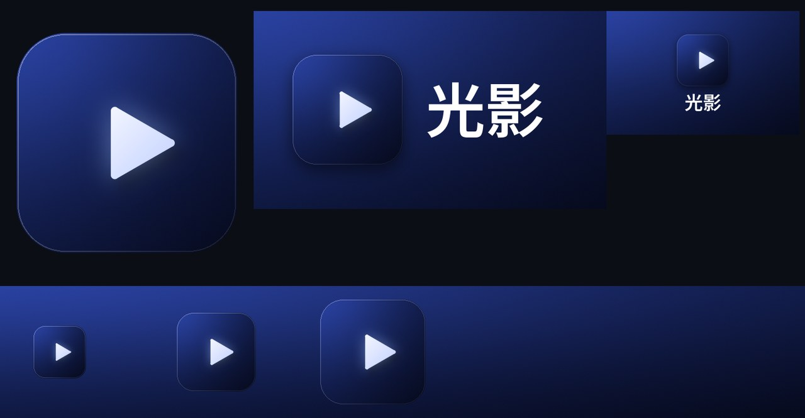

# 光影 · fongmi-appletv-skin

给 [FongMi/TV](https://github.com/FongMi/TV)（影视 TV）换一套 Apple TV（tvOS）风格的界面。
不改功能、不碰代码：把官方发布的 APK 解包，覆盖一层界面资源，再用自己的密钥签名，打包成一个独立的应用 **光影**（`local.guangying.tv`），可以和官方的「影视」同时安装。官方出新版，跑一条命令就能跟上。

[English](#english) · 设计参考：[映匣 Yingxia](https://github.com/jo32/tvbox-silicon)（tvOS 原生 TVBox 客户端）、[Aerial](https://github.com/pengchujin/aerial-tv)、[Apple HIG](https://developer.apple.com/design/human-interface-guidelines/designing-for-tvos)



## 效果

| | |
|---|---|
|  首页：来源按钮、胶囊功能区、圆角海报 |  详情页：大标题、灰色元数据、线路/集数胶囊 |
|  播放控制条：玻璃面板、细进度条 |  直播：白底聚焦的频道列表 |
|  搜索：tvOS 键盘与输入框 |  设置：白底黑字的焦点 |




### 做了什么

- **配色**：映匣现版的深蓝底 `#050917`，聚焦一律白底黑字，当前项浅灰，不用任何主题色，颜色留给海报。
- **字体**：Inter（SF Pro 的开源替代，Aerial 同款），默认 Medium 字重；19sp 以上用 Display 字形；中文回落到系统字体。
- **焦点**：tvOS 的五种状态（静止 / 聚焦 / 按下 / 当前 / 禁用），180ms 减速动画，聚焦轻微放大并抬起，海报带白色描边和高光。
- **毛玻璃**：对话框和侧边面板在 Android 12+ 上由系统实时模糊背景；更早的系统退为近不透明面板。
- **图标**：Material Symbols Rounded 实心款（SF Symbols 的授权只允许用在 Apple 平台）。
- **动效**：页面打开时内容淡入并从略大缩回；空闲时没有任何持续动画。
- **布局**：按 HIG 的安全区留边；页面标题、分区标题、输入框、加载与空状态都按 tvOS 的样子重做。
- **品牌**：自绘的图标、电视桌面横幅、启动画面；TCL/雷鸟桌面（cyberui）可直接显示整张卡片。
- **关闭自动更新**：唯一一处改动代码——把检查更新的地址改成一个不存在的域名，官方更新包签名不同装不上，索性不提示。

### 没做（需要改代码）

左侧边栏导航、首页直接显示分类、焦点固定内容滚动、进入详情不自动播放、随焦点变化的背景、时钟去秒。
这些要从源码编译，而当前版本依赖的播放器库尚未公开，见 [FongMi/TV#764](https://github.com/FongMi/TV/issues/764)。

切换源的列表打开时先停在第一项、再跳到当前源，这是上游的行为（对话框先显示，再 `post` 一次 `scrollToPosition`），不是皮肤造成的：
在同一台电视上用官方 APK 测得一样的跳动。每帧的布局耗时和站点数成正比（小米 75 寸上约每站 10 ms），所以订阅里站点越少跳动越短；
皮肤侧试过固定列表高度、去掉复选框动画图标、关闭窗口模糊，都没有改善，已全部撤回。

## 构建

需要：JDK 17+、Android SDK（`ANDROID_HOME` 指向它，用最新的 build-tools）、Python 3.11 + Pillow + numpy。

```sh
# 生成自己的签名密钥（只做一次，别丢）
keytool -genkeypair -keystore keys/skin.jks -alias skin -keyalg RSA -keysize 3072 -validity 36500
printf 'storeFile=keys/skin.jks\nkeyAlias=skin\nstorePassword=<密码>\n' > keys/skin.properties

# 下载官方 leanback-<abi>.apk、解包、覆盖皮肤、签名
python -I tools/build.py --version 5.8.2 --abi armeabi_v7a     # -> out/guangying-5.8.2-armeabi_v7a.apk
adb install -r out/guangying-5.8.2-armeabi_v7a.apk
```

官方升级后，换个 `--version` 再跑一遍。`build.py` 会从新版本重新生成派生的布局和样式；如果官方改了某个手写覆盖的布局的 view id，`check_ids` 会报出具体文件，同步后再构建。

**内置订阅入口**：APK 里打包了 `assets/tv.json`（指向 [NavyL/tv-sub](https://github.com/NavyL/tv-sub) 的精选单仓，GitHub Pages 主地址、jsDelivr 备用、多仓索引三条）。首次使用在 设置 → 点播 输入 `assets://tv.json` 即可，不用再输长地址。FongMi 本身没有"默认订阅"机制，真正免输入需要改代码，资源皮肤做不到。

**从官方「影视」迁移数据**：在影视里 设置 → 备份，再到光影里 设置 → 恢复（两边共用 `/sdcard/TV/backup`）。订阅自带壁纸的，装好后在 设置 → 壁纸 行按 🏠 切回内置壁纸。

**限制**：用自己的密钥签名后，装不了官方的运行时模块（`com.fongmi.runtime.*`，有签名校验）。

## 测试

```sh
pip install pytest
python -m pytest            # 190 个用例，不到一秒
```

覆盖：`patch_dex`（合成的 dex 文件：替换、校验和、排序保护、锚点缺失）、`check_ids`、`merge_values`、清单改写、`unclip`、`gen_rows`，以及对 `skin/res` 的静态检查（XML 合法、无重复资源、自有引用都能解析、每个布局标明来源）。`work/` 下有解包好的官方 APK 时，还会对照真实布局校验 id，并确认关更新的锚点字符串仍在。

## 仓库结构

| 路径 | 内容 |
|---|---|
| `skin/res/` | 资源覆盖层。`values/*.xml` 按资源名合并进官方资源；其他目录按文件名整个替换 |
| `skin/brand.json` | 应用身份：包名、名称、TCL 桌面卡片 |
| `tools/build.py` | 下载 → `apktool d` → 覆盖 → 品牌 → 关更新 → `apktool b` → zipalign → apksigner |
| `tools/check_ids.py` | 替换的布局必须保留官方的每个 view id 和类型（ViewBinding） |
| `tools/gen_rows.py` / `gen_type.py` | 从官方布局和 Material 3 字体样式生成 tvOS 版本，每次构建自动运行 |
| `tools/gen_selectors.py` / `gen_icons.py` / `import_wallpapers.py` / `gen_brand.py` | 五态选择器、图标、壁纸（四张图 → `wallpaper_1..4.webp`；`gen_wallpapers.py` 是无图时的代码画法）、品牌素材（`gen_brand.py --source skin/brand-source.png` 从一张方形图派生图标、横幅、启动画面和桌面卡片） |
| `tools/patch_dex.py` | 关闭自动更新（替换一个 URL 字符串，修正 dex 校验和） |
| `tools/emu.sh` / `focus.py` / `readme_images.py` | 模拟器验收与 README 配图工具 |
| `tests/` | pytest 用例，见上 |

## 许可

GPL-3.0，与 FongMi 一致。本仓库只提供工具和资源覆盖层，**不分发任何 APK**；请自行下载官方包构建。
字体 Inter 与 Noto Sans SC：SIL OFL；图标 Material Symbols：Apache 2.0。光影与 FongMi 无关。

---

## English

An Apple TV (tvOS) style skin for [FongMi/TV](https://github.com/FongMi/TV), applied to the official release APK as a resource overlay — no code changes, no fork to maintain. The result is a separate app, **光影** (`local.guangying.tv`), that installs beside the official one; when FongMi releases a new version, one command rebuilds the skin on top of it.

Design follows [Yingxia](https://github.com/jo32/tvbox-silicon) (a native tvOS TVBox client), [Aerial](https://github.com/pengchujin/aerial-tv) and Apple's HIG: navy canvas, white focus with black content, Inter typography, five focus states, blurred glass sheets (Android 12+), Material Symbols icons, content fade on screen open, title-safe margins.

```sh
python -I tools/build.py --version 5.8.2 --abi armeabi_v7a   # -> out/guangying-5.8.2-armeabi_v7a.apk
```

Needs JDK 17+, an Android SDK (`ANDROID_HOME`), Python 3.11 with Pillow and numpy, and your own keystore in `keys/` (see 构建 above). The only code change is `tools/patch_dex.py`, which disables the self-update check. Re-signed builds cannot install FongMi's runtime modules. `python -m pytest` runs the test suite. GPL-3.0; no APKs are distributed here.
